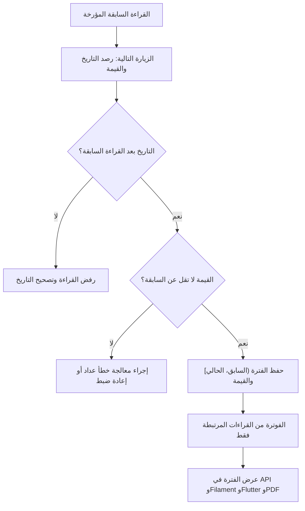

# مفهوم فترة استهلاك المياه: من قراءة العداد السابقة إلى القراءة التالية

**التاريخ:** 22 نوفمبر 2026  
**حالة التصميم:** فرع `reading-boundaries-20261122`، لا يُستخدم في الإنتاج قبل اكتمال الفحوص ودمجه.  
**القرار:** نهاية دورة الزيارة أو نهاية الشهر ليست نهاية فترة الاستهلاك؛ فترة الفاتورة ناتجة عن قياسين فعليين متتاليين.

## 1. التعريف المحاسبي والتشغيلي

- **الحد الأول:** تاريخ القراءة السابقة للعداد وقيمتها.
- **الحد الثاني:** تاريخ القراءة الحالية للعداد وقيمتها.
- **الفترة:** `(previous_observation_date, current_observation_date]`، مع اشتراك الدورات المتجاورة في نقطة قياس واحدة.
- **الاستهلاك:** `current_reading_value - previous_reading_value`، مع منع السالب؛ لا تُحسب أي وحدة مرتين.
- **الفاتورة:** تختزن الحدين من القراءة أو القراءات المرتبطة بها. **تاريخ إصدار الفاتورة ليس تاريخ القراءة**، وكذلك تاريخ إدخال السجل ليس تاريخ الرصد إذا سُجل تاريخ فعلي منفصل.
- **أسبوعي/كل 10 أيام/نصف شهري/شهري:** تكرارات لزيارة قارئ العداد فقط. يُعرض الموعد المتوقع في الواجهة ولا تُفرض الفترات المالية وفق الجدول.

مثال: قراءة بتاريخ **5 يناير** قيمتها **120**، وقراءة بتاريخ **8 فبراير** قيمتها **155**. الاستهلاك **35 وحدة** والفترة المعروضة **5 يناير–8 فبراير**، بصرف النظر عن موعد زيارة الموظف المخطط.

## 2. التسلسل

## 3. القراءة الأولى للعداد

يحتاج النظام مرجعاً ميدانياً صالحاً:
1. **تاريخ تركيب العداد** مع قراءة البداية `initial_reading` إن كان محدداً؛ وإلا **تاريخ بدء الخدمة** كنقطة مرجعية مؤقتة معلومة.
2. لا يُسمح بإنشاء قراءة أولى دون أي تاريخ مرجعي؛ لا نخترع اليوم الأول للشهر.
3. عند استبدال العداد، تُعتمد لحظة تركيب الجديد كنقطة البداية ولا تُخلط قيم عدادين مختلفين.

## 4. القراءات التاريخية

القراءات القديمة قد تخلو من `actual_reading_date`. لا يُستدل آلياً أن `reading_date` هو الرصد الميداني؛ إن توفرت `period_end` التاريخية فهي المرجع المتحفظ المتاح لترحيل القراءات **الجديدة فقط**. لا تُعدّل فواتير قديمة أو أموال أو أرصدة آلياً.

## 5. التحقق والاحتواء

- منع تاريخ قراءة مستقبلية، ومنع يوم مساوٍ أو سابق لآخر رصد.
- منع تداخل الفترات ذات الاستهلاك؛ اشتراك الفترات في تاريخ القياس الحدّي مسموح.
- عدم قبول فترات الجدول القديم من طلبات الأجهزة بصفتها مصدراً للحقيقة؛ يعيد الخادم بناءها بعد قفل العداد وعند المزامنة.
- إعادة إرسال `sync_uuid` بنفس التاريخ والقيمة تُعامل كمحاولة مكررة. تغيير تاريخ الرصد لنفس UUID تعارض؛ لا يتم خلق قراءة جديدة أو إعادة استخدام قراءة خاطئة.
- يمنع تعديل قيمة/تاريخ قراءة إذا كانت هناك قراءة لاحقة تعتمد عليها أو كانت مفوترة، إلا عبر مسار تصحيح محاسبي وتسلسلي معتمد.
- فاتورة يدوية غير مرتبطة بقراءة لا تُعطى تلقائياً تاريخ بداية الشهر ونهايته. إن أعطى المستخدم فترة يدوياً فلا تزال تحتاج سياسة اعتماد لعدم تقديمها كقياس موثوق.

## 6. شروط قبول الإنتاج

- [ ] تمر اختبارات Laravel على SQLite وMySQL، وتحليل Flutter واختبارات واجهاته والمزامنة دون اتصال.
- [ ] تظهر فترة القراءة الفعلية نفسها في شاشة إدخال القراءة وواجهات الفاتورة وPDF.
- [ ] يعمل التعديل والمزامنة دون انقطاع للتسلسل وبلا فواتير/أرصدة متناقضة.
- [ ] يُراجَع التعامل مع القراءات الأربع ذات فترات مستقبلية في لقطة المستخدم السابقة دون تعديل صامت.
- [ ] اعتماد سياسة فواتير الاستهلاك اليدوية التي لا ترتبط بقراءة، وسياسة تصحيح القراءات المفوترة.
- [ ] تجربة الترقية على جهاز قديم ونسخة MySQL معزولة من قاعدة البيانات الحقيقية.

**مهم:** اجتياز CI لا يعني أن النسخ التاريخية وبيئة التشغيل قد خضعتا لتسوية أو إعادة احتساب؛ لا تُجري ترحيلاً هدّاماً بناءً على هذا التغيير.
