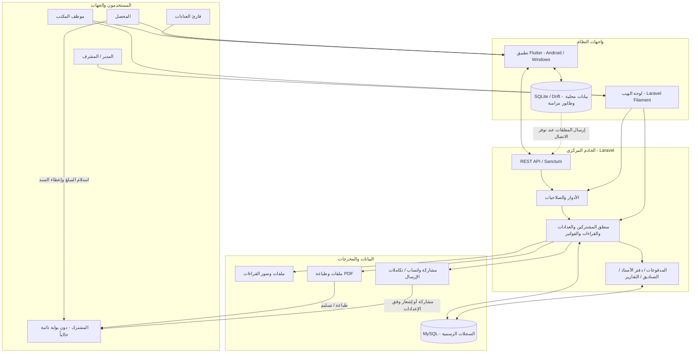
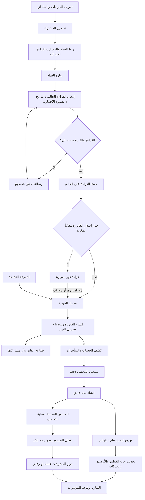
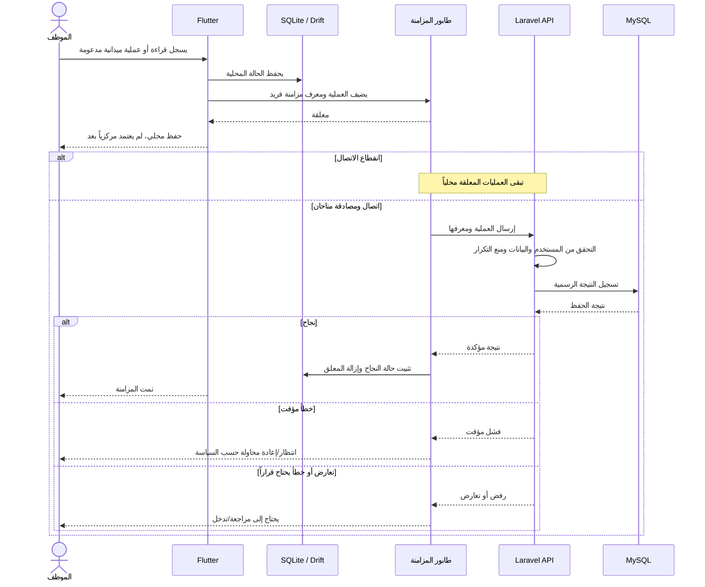
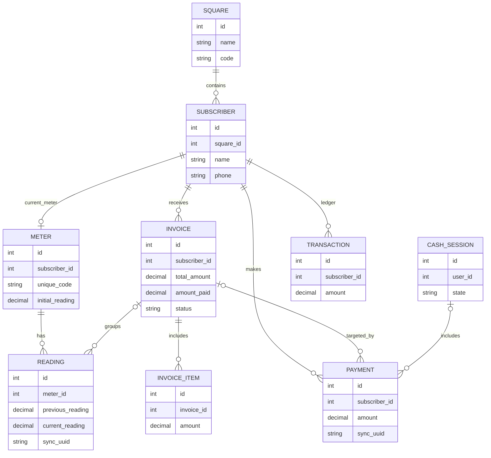

# المخطط المتكامل لمشروع Water

> **نوع المستند:** مرجع معماري وتشغيلي قابل للتحديث — مخططات Mermaid مدمجة في Markdown.
>
> **نطاق الدراسة:** مستودع `5krm/water`؛ Laravel / Filament وFlutter وواجهات API وقاعدة البيانات والمزامنة. أُعدّت هذه المخططات استناداً إلى قراءة الشيفرة ووثائق المشروع، وليست دليلاً على نجاح التشغيل أو اختبارات القبول.
>
> **تاريخ التوثيق:** 2026-11-12. **حالة المشروع:** تطوير؛ لا طرح إنتاجي معتمد. **حدود التغيير:** توثيق فقط، بلا تعديلات تشغيلية.
>
> **مهم:** صيانة هذه المخططات مرتبطة بأي تعديل في قواعد الأعمال أو مسارات API أو نماذج البيانات أو صلاحيات المستخدم.

## الفهرس

1. [المعمارية العامة](#1-المعمارية-العامة)
2. [دورة الأعمال من المشترك إلى التحصيل](#2-دورة-الأعمال-من-المشترك-إلى-التحصيل)
3. [رحلة الموظف وواجهات الأدوار](#3-رحلة-الموظف-وواجهات-الأدوار)
4. [مزامنة العمل دون اتصال](#4-مزامنة-العمل-دون-اتصال)
5. [نموذج علاقات البيانات](#5-نموذج-علاقات-البيانات)
6. [سيناريو تشغيل من البداية للنهاية](#6-سيناريو-تشغيل-من-البداية-للنهاية)
7. [مصادر الشيفرة وملاحظات الحدود](#7-مصادر-الشيفرة-وملاحظات-الحدود)

## 1. المعمارية العامة



**المبدأ:** يتفاعل الموظفون مع واجهات مختلفة، لكن الخادم هو المرجع الرسمي للهوية والبيانات المحاسبية والحسابات المعتمدة. يدعم العميل تخزين بعض العمليات محلياً عند الانقطاع؛ لا يُعتبر حفظ العملية محلياً اعتماداً من الخادم.

**ملاحظة مهمة:** المشترك ليس مستخدماً لتطبيق مستقل في نطاق المشروع الحالي؛ التواصل معه عبر الموظف والمستندات والخدمات المتاحة.

## 2. دورة الأعمال من المشترك إلى التحصيل



### قواعد الأعمال الحرجة

- التحقق من أن القراءة الحالية لا تقل عن السابقة، ومن سلامة الفترة ومنع إعادة تسجيل الفترة نفسها يتم في الخادم.
- قراءة العداد تظل غير مفوترة حتى يصدر لها مستند، إلا عندما يُفعّل إعداد الإصدار التلقائي وينجح إنشاء الفاتورة.
- يحسب `InvoiceService` رسوم استهلاك المياه فقط وفق التعرفة النشطة والقراءات غير المفوترة. تظهر المتأخرات السابقة للعرض دون إعادة تحميلها في إجمالي الدين الجديد.
- تُنشئ الفاتورة حركة دين، وتوزع `PaymentService` المدفوعات على المستحقات وتُحدّث حالة الفواتير والرصيد.
- إجراءات إقفال الصناديق واعتمادها منفصلة عن تسجيل سند القبض، وتعتمد على أدوار المستخدمين.
- هذه خريطة عمل طبيعية؛ توجد عمليات تعديل/حذف وإلغاء وتحكم وصلاحيات لا يعرضها المخطط لتجنب ازدحامه.

## 3. رحلة الموظف وواجهات الأدوار

```mermaid
flowchart TB
    OPEN["فتح Water"] --> SETUP["إعداد عنوان الخادم عند الحاجة / تسجيل الدخول"]
    SETUP --> OK{"المصادقة ناجحة؟"}
    OK -- "لا" --> SETUP
    OK -- "نعم" --> HOME["الرئيسية / الخدمات المرئية حسب الصلاحيات"]
    HOME --> CHOICE{"الوظيفة المطلوبة"}
    CHOICE --> CUSTOMER["المشتركون والخدمات"]
    CHOICE --> FIELD["العدادات والقراءات"]
    CHOICE --> MONEY["الفواتير والتحصيل"]
    CHOICE --> ADMIN["الإدارة والتقارير"]
    CHOICE --> ACCOUNT["الحساب والمزامنة"]
    CUSTOMER --> CU2["مشترك جديد / المربعات / كشف الحساب / الوايت"]
    FIELD --> FI2["مسار ميداني / بحث / باركود / قراءة"]
    MONEY --> MO2["فاتورة / سند قبض / صندوق المحصل"]
    ADMIN --> AD2["مؤشرات / صلاحيات / تعرفة / مراجعة الصناديق"]
    ACCOUNT --> AC2["حالة المزامنة / النسخة المحلية / الملف الشخصي"]
    CU2 --> RESULT["عرض النتيجة أو الرسالة"]
    FI2 --> RESULT
    MO2 --> RESULT
    AD2 --> RESULT
    AC2 --> RESULT
    RESULT --> HOME
```

| الفئة | المهام الرئيسية | الواجهة الغالبة |
| --- | --- | --- |
| المدير والمشرف | إعداد المشروع والصلاحيات والتعرفة، التدقيق، التقارير، مراجعة الصناديق والإلغاءات | Filament / Flutter بحسب الصلاحيات |
| موظف المشتركين | بيانات المشترك والمربع والعداد والاشتراك والوايت وكشف الحساب | Filament أو Flutter |
| قارئ العدادات | مسارات ميدانية، باركود، قراءة وصور وأعطال وزيارات ومزامنة | Flutter |
| المحصل | صندوق، بحث عن الدين، دفع، سند، طباعة، تسوية | Flutter |
| المشترك | يقدم بياناته، ويتلقى الفواتير والسندات ويدفع عبر الموظف | خارج واجهة تسجيل الدخول الحالية |

**الضبط:** إظهار خيار في Flutter يعتمد على الصلاحيات المحملة، لكن **قرار السماح النهائي لأي عملية يقع على الخادم**. لا ينبغي اعتبار إخفاء زر حماية أمنية بحد ذاته.

## 4. مزامنة العمل دون اتصال



### القواعد التشغيلية للمزامنة

- يدعم النظام طوابير محلية لبعض عمليات القراءات والتحصيل والإلغاء وإقفال الصندوق؛ **لا يعني ذلك أن كل وحدة تعمل دون اتصال**.
- ترتيب الأولوية المعرّف في `SyncQueueOrder`: تحصيل الدفع، ثم إلغاء الدفع، ثم إقفال الصندوق، ثم القراءات؛ الأقدم أولاً داخل الفئة.
- يمنع مدير الطابور إرسال المعرف نفسه بالتزامن على الجهاز، ويستخدم معرّفات مزامنة للمساعدة على منع التكرار عند إعادة الإرسال.
- الخطأ الذي يحتاج مراجعة بشرية لا يُعاد تلقائياً. وتوجد حالات مؤقتة لمحاولة الإرسال مجدداً.
- الرسم **منطقي مبسط**؛ استجابة الخادم قد تتضمن نجاحاً جزئياً في دفعات القراءة، ومسارات الفشل قد توقف إرسال عناصر تعتمد على عمليات سابقة.
- **الحالة المعلقة ليست قبضاً نهائياً ولا فاتورة مؤكدة** حتى يأتي التأكيد من الخادم.

## 5. نموذج علاقات البيانات



**ملاحظة النمذجة:** مخطط البيانات الحالي لا يدعم تخزين أكثر من سجل عداد واحد للمشترك. لا يُحتفظ بالعدادات التاريخية المحذوفة ولا بنموذج رسم اشتراك مالي. التفاصيل وخطوات ترحيل البيانات في [وثيقة العداد الواحد](SINGLE_CURRENT_METER_CHANGE_AR.md). يوضح الرسم علاقات Eloquent الأساسية، وليس مخطط DDL بكل الجداول والفهارس والأعمدة. في السداد، الربط المباشر بـ`invoice_id` اختياري؛ وقد توزَّع الدفعة محاسبياً على أكثر من فاتورة، لذلك لا يمثل الخط وحده جميع تخصيصات السداد. كذلك قد ترتبط الفاتورة بعدة قراءات.

## 6. سيناريو تشغيل من البداية للنهاية

1. **التسجيل:** موظف مخوّل يعرّف مربعاً، ويسجل مشتركاً، ثم يربط عداداً بقراءة ابتدائية ومسار ميداني.
2. **الزيارة:** القارئ يفتح المسار أو يبحث عن العداد، ويدخل القراءة وصورة اختيارية.
3. **التحقق:** يفحص الخادم السابقة والفترة، ويتأكد من أن العملية ليست تكراراً.
4. **الفوترة:** عند تفعيل الفوترة التلقائية أو اختيار إصدار يدوي/جماعي، تُنشأ فاتورة وبنودها وحركتها المحاسبية.
5. **السداد:** المحصل يفتح المشترك/الفاتورة ويُدخل المبلغ وطريقة الدفع؛ يسجل الخادم سند القبض ويحدّث توزيع المدفوعات والأرصدة.
6. **الصندوق:** يراجع المحصل الصندوق ويقفل المبلغ؛ يراجع المشرف النتيجة وفق صلاحياته.
7. **الإدارة:** تظهر البيانات المؤكدة في كشف حساب المشترك والتقارير ولوحة المؤشرات.

**قيد الفوترة:** لا تصدر فاتورة جديدة دون قراءات مياه غير مفوترة للعداد الحالي. يمكن أن تبقى قراءة جديدة غير مفوترة حتى إصدار فاتورتها.

## 7. مصادر الشيفرة وملاحظات الحدود

| المحور | ملفات المصدر |
| --- | --- |
| الدخول والمصادقة وواجهات API | [routes/api.php](../../routes/api.php)، [AuthController.php](../../app/Http/Controllers/Api/AuthController.php) |
| فهرس الخدمات وصلاحيات ظهورها في Flutter | [module_catalog.dart](../../mobile%20app/lib/core/navigation/module_catalog.dart)، [workspace_catalog.dart](../../mobile%20app/lib/features/home/domain/workspace_catalog.dart) |
| القراءات والتحقق | [ReadingController.php](../../app/Http/Controllers/Api/ReadingController.php)، [ReadingService.php](../../app/Services/ReadingService.php) |
| الفوترة | [InvoiceService.php](../../app/Services/InvoiceService.php)، [InvoiceController.php](../../app/Http/Controllers/Api/InvoiceController.php) |
| التحصيل والصناديق | [PaymentService.php](../../app/Services/PaymentService.php)، [CashSessionController.php](../../app/Http/Controllers/Api/CashSessionController.php) |
| المزامنة | [sync_queue_manager.dart](../../mobile%20app/lib/features/offline_sync/services/sync_queue_manager.dart)، [sync_queue_order.dart](../../mobile%20app/lib/features/offline_sync/domain/sync_queue_order.dart) |
| العلاقات الأساسية | [Models](../../app/Models) |
| تدقيق المخاطر المؤجلة | [PREPRODUCTION_AUDIT_2026-11-12_AR.md](../v2/qa/PREPRODUCTION_AUDIT_2026-11-12_AR.md) |

**حدود الثقة:** المخططات تصف ما ظهر في شيفرة المستودع عند إعدادها، ولا تشهد بصحة الأرصدة أو نجاح تشغيل الجهاز أو الاختبارات. مشكلات الأمان والمحاسبة السابقة ما زالت موثقة ومؤجلة إلى مرحلة ما قبل الإنتاج، ولم تُصلَح عند إضافة هذه الرسومات.

### صيانة المخططات

- عدّل Mermaid مباشرةً داخل هذا الملف كلما تغيّر مسار عمل أو نموذج أو عقد API.
- استخدم معاينة GitHub للتأكد من سلامة عرض الرسم.
- قبل اعتماد التغيير راجع الاتساق مع `routes/api.php` و`app/Models` ووحدات Flutter و`backlog.json`.
