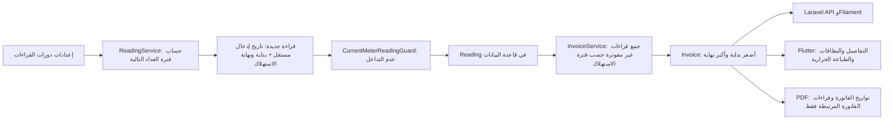

# التدقيق المستقل لفترات قراءة العدادات وظهورها في فواتير المياه

**التاريخ:** 22 نوفمبر 2026  
**المستودع:** `5krm/water`  
**فرع الإصلاح:** `audit-reading-periods-20261122`  
**المصدر السابق للتعديل:** `main` عند `e0375c949bdac8b0a4320feb813dd813d9be2160`  
**الحالة:** تصحيحات قابلة للاختبار ومتحقَّق منها آلياً؛ يحتاج تأكيد ميداني وقاعدة بيانات المستخدم المباشرة.

> تنبيه: هذا التقرير لا يصرّح بتعديل أو إلغاء بيانات مالية تاريخية. لا يجوز تعميم نتائج لقطة SQL قديمة على قاعدة تشغيل أحدث.

## 1. ما الذي تعنيه حقول التاريخ؟

| الحقل | المعنى | أين يُخزن |
| --- | --- | --- |
| `period_start` | بداية الاستهلاك المشمول بالقراءة | `readings` |
| `period_end` | نهاية الاستهلاك المشمول بالقراءة | `readings` |
| `reading_date` | يوم تسجيل/اعتماد قراءة العداد، وقد يأتي بعد نهاية الدورة | `readings` |
| `actual_reading_date` | التاريخ الفعلي المنفصل إن سُجّل | `readings` |
| `billing_period_start` | أصغر بداية فترة من قراءات الفاتورة | `invoices` |
| `billing_period_end` | أكبر نهاية فترة من قراءات الفاتورة | `invoices` |
| `bill_date` | تاريخ إصدار الفاتورة؛ لا يُعد فترة استهلاك | `invoices` |

## 2. دورات القراءة

| إعداد الدورة | نهاية الفترة المتوقعة |
| --- | --- |
| أسبوعي | بعد 6 أيام من البداية، شاملة تاريخ البداية |
| كل عشرة أيام | 10 أو 20 أو آخر يوم في الشهر |
| نصف شهري | 15 أو آخر يوم في الشهر |
| شهري | آخر يوم بالشهر أو يوم ضبطه المشرف |
| شهر قصير مع إعداد يوم 31 | آخر يوم فعلي بالشهر، دون الانتقال خطأً إلى الشهر التالي |

عند وجود قراءة سابقة، تبدأ الفترة الجديدة في اليوم التالي **لنهاية الفترة السابقة**، لا في اليوم التالي لتاريخ إدخال القراءة.

## 3. تدقيق نسخة SQL التي شاركها المالك

**الملف:** `water_project_without_tanker_tenant_subscription_fees.sql` (398603 بايت).  
**تاريخ إنشاء اللقطة المطبوع داخل الملف:** 22 أكتوبر 2026.  
**منهج الاختبار:** قراءة أوامر INSERT وتحليل علاقات المعرّفات وفترات القراءة، دون استيراد الملف إلى قاعدة تشغيل.

| المقياس | العدد |
| --- | ---: |
| إجمالي القراءات | 242 |
| إجمالي الفواتير | 351 |
| قراءات لها فاتورة مرتبطة | 236 |
| فواتير نشطة لها قراءات مرتبطة | 235 |
| فواتير محذوفة حذفاً ناعماً دون قراءات مرتبطة | 116 |
| حالات عدم تطابق فترة الفاتورة مع أصغر بداية وأكبر نهاية لقراءاتها | **0** |
| قراءات أُدخلت بعد نهاية فترة الاستهلاك | 224 |
| قراءات أُدخلت ضمن فترة الاستهلاك | 14 |
| قراءات أُدخلت قبل بداية فترة الاستهلاك | **4** |
| قراءات حقل `actual_reading_date` فيها NULL | 242 |

**تفسير مهم:** كون تاريخ الإدخال بعد نهاية الاستهلاك لا يعني وجود خطأ محاسبي؛ فقد تتأخر الزيارة أو إدخال القراءة. ولا يصح الاعتماد على `reading_date` لاختيار القراءات التي تخص فاتورة بتاريخ الفترة.

### حالات تحتاج قراراً من المالك

في العداد رقم **95**، القراءات 419 و420 و421 و422 أُدخلت في أكتوبر 2026، رغم أن فتراتها تبدأ في نوفمبر 2026، ديسمبر 2026، يناير 2027، فبراير 2027 على الترتيب. ترتبط بفواتير 580 و581 و582 و583. الفترات المخزنة على الفواتير مطابقة للقراءات؛ المشكلة **احتمال تسجيل استهلاك مستقبلي قبل بدايته**.

**مهمة المتابعة:** [#43](https://github.com/5krm/water/issues/43). لا تُعدَّل هذه الفواتير والقراءات صامتاً، ولا يُفرض حظر بأثر رجعي قبل تقييم المقصود بها.

## 4. الأخطاء البرمجية التي عالجها فرع التدقيق

1. فحص آخر قراءة وأول وآخر قراءة مفوترة وفق `period_end`/`period_start` بدلاً من الاعتماد على ترتيب إدخال السجل أو تاريخ التسجيل.
2. حفظ فترة الفاتورة من أصغر `period_start` وأكبر `period_end` بين قراءاتها، حتى عندما تصل عدة قراءات بترتيب متداخل من حيث تاريخ الإدخال.
3. منع مسار PDF من تخمين قراءات أخرى للعداد تقع تواريخ إدخالها داخل الفترة؛ **القراءات المرتبطة بالفاتورة وحدها هي مصدر القيم**.
4. منع `InvoiceController::recalculate` من استعارة قراءة ليست مرتبطة بالفاتورة؛ عند وجود قراءات مرتبطة يُستعاد نطاق الفاتورة الفعلي منها.
5. رفض تعديل تواريخ فترة فاتورة ذات قراءات مرتبطة إذا لم تطابق فترة تلك القراءات، والتحقق من ألا تكون نهاية الفترة أقدم من بدايتها.
6. رفض تداخل **الفترات الجزئي** عند تحديث قراءة من API، بدلاً من فحص التطابق الكامل فقط.
7. منع تجاوز نهاية الشهر في حال ضبط يوم قراءة أعلى من عدد أيام الشهر.
8. توحيد تخزين التاريخ الفعلي لقراءات API وFilament الجديدة، ومراعاة الحقل عند تعديل تاريخ الإدخال دون محو تاريخ فعلي مختلف عمداً.
9. إظهار بدايتي ونهايتي الفترة في جداول القراءات والفواتير ونموذج الفاتورة في Filament.
10. عدم اختراع فترة «الشهر السابق» في PDF عندما تكون تواريخ الفترة غير محفوظة، وإظهار قيمة غير محددة بدل أرقام قراءة أو سعر وحدة مفترضين.

## 5. اختبارات القبول

أُضيفت `tests/Feature/ReadingPeriodInvoiceConsistencyTest.php` مع اختبارات لتطابق الفترة، والأشهر القصيرة، والقراءات المتأخرة، ومنع التداخل، واستقلال PDF، وإعادة الاحتساب، وتعديل الفواتير والتواريخ الفعلية.

- [نجاح مجموعة الاختبارات على SQLite وMySQL 8، مع Laravel الكامل](https://github.com/5krm/water/actions/runs/45050993689).
- [فحوص الميزات القديمة](https://github.com/5krm/water/actions?query=workflow%3A%22Retired+feature+removal+gate%22) تظل مطلوبة لمنع العودة غير المقصودة إلى مسارات الفوترة الملغاة.
- ينطلق الفحص تلقائياً من `.github/workflows/reading-period-acceptance.yml`.

## 6. حدود القبول المتبقية

- [ ] تشغيل سيناريو حقيقي من إدخال قراءة إلى إصدار فاتورة وعرضها وطباعتها على Laravel/Filament وAndroid/Windows.
- [ ] التحقق من المزامنة دون اتصال عند إدخال قراءة متأخرة وبعد تغيير إعداد دورة القراءة.
- [ ] مراجعة القراءات الأربع ذات الفترات المستقبلية مع صاحب المشروع، وعدم إلغاء القيود المالية دون تسوية معتمدة.
- [ ] قرار موثق بشأن الفواتير اليدوية التي لا تستند إلى قراءة مرتبطة وقد تقبل فترة افتراضية؛ لا يُفترض أنها فاتورة دورة قراءة فعلية.
- [ ] استيراد نسخة SQL في MySQL معزول واختبار الفواتير وملفات PDF بأرقامها الحقيقية، بالإضافة إلى مقارنة مع قاعدة التشغيل الأحدث.

**قاعدة العمل:** لا تُعدل بيانات المستخدم الحقيقية، ولا تُغلق نتائج التدقيق باعتبارها 100% قبولاً إنتاجياً قبل فحوص التشغيل والبيانات المذكورة.
