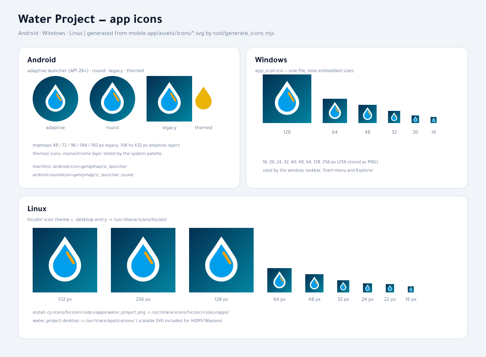

# App icons

One mark, generated for every platform the project ships. All binaries are
produced from the SVG sources in this folder — never edit the PNG/ICO outputs by
hand.



## The mark

A water droplet in a white ring on a deep-teal tile, with a single amber
highlight. Colours are taken from the app theme
(`lib/core/theme/app_colors.dart`) so the launcher icon and the UI agree:

| Role            | Colour    | Used by                                     |
| --------------- | --------- | ------------------------------------------- |
| Background deep | `#042F51` | gradient start (≈ `AppColors.primaryDark`)   |
| Background mid  | `#025B7A` | gradient middle (≈ `AppColors.primary`)      |
| Background warm | `#0285A2` | gradient end                                 |
| Ring / outline  | `#FDFDFD` | droplet ring                                 |
| Droplet water   | `#019EEB` | droplet fill (≈ `AppColors.secondary`)       |
| Highlight       | `#FDA107` | amber accent (≈ `AppColors.brandAmber`)      |

## Sources

| File                      | Size      | Purpose                                             |
| ------------------------- | --------- | --------------------------------------------------- |
| `app_icon.svg`            | 1024×1024 | Full-bleed master: Play Store, docs, adaptive background, Linux 512 |
| `app_icon_compact.svg`    | 1024×1024 | Same mark at 130 % for small legacy/desktop sizes (16–192 px) |
| `app_icon_foreground.svg` | 108×108   | Transparent Android adaptive foreground layer        |
| `app_icon_monochrome.svg` | 108×108   | Android 13 themed-icon silhouette                    |
| `app_icon_master.png`     | 1254×1254 | Original artwork the vectors were traced from        |

`app_icon_compact.svg` exists because a launcher icon is drawn smaller than a
store icon: at 48 px the ring of the master art becomes a blur, so the compact
variant enlarges the droplet to fill the tile.

## Generating

```sh
cd "mobile app/tool"
npm install          # once, installs @resvg/resvg-js
node generate_icons.mjs
```

The script rewrites every output below plus `preview.png`. It requires Node 18+
and no other tooling — no Flutter, Android SDK, ImageMagick or Python.

## Outputs

### Android

```
android/app/src/main/res/
  mipmap-mdpi … mipmap-xxxhdpi/ic_launcher.png            48, 72, 96, 144, 192 px
  mipmap-mdpi … mipmap-xxxhdpi/ic_launcher_round.png      round-masked legacy icon
  mipmap-mdpi … mipmap-xxxhdpi/ic_launcher_foreground.png 108, 162, 216, 324, 432 px
  mipmap-mdpi … mipmap-xxxhdpi/ic_launcher_monochrome.png same densities
  mipmap-anydpi-v26/ic_launcher.xml, ic_launcher_round.xml  adaptive (API 26–32)
  mipmap-anydpi-v33/ic_launcher.xml, ic_launcher_round.xml  + monochrome (API 33+)
  drawable/ic_launcher_background.xml                      gradient background
```

`AndroidManifest.xml` references both entry points:

```xml
android:icon="@mipmap/ic_launcher"
android:roundIcon="@mipmap/ic_launcher_round"
```

The adaptive foreground keeps the droplet inside the 66 dp safe zone, so
circular, squircle, rounded-square and teardrop launcher masks all crop the
tile without cutting the mark. The monochrome layer is a solid silhouette that
Android tints with the user's wallpaper palette on Android 13+.

Play Store upload asset: `ic_launcher-playstore-512.png` (512×512, 32-bit PNG).

### Windows

```
windows/runner/resources/app_icon.ico   16, 20, 24, 32, 40, 48, 64, 128, 256 px
```

One multi-resolution ICO. Sizes below 256 are stored as 32-bit BGRA DIBs (the
format every Windows shell version reads); 256 is embedded PNG. The Flutter
runner already loads it through `Runner.rc` (`IDI_APP_ICON`), so window chrome,
taskbar, Start menu, Alt-Tab and Explorer all pick it up. It is used both by
`flutter build windows` and by installer tools that read the app icon.

### Linux

```
linux/icons/hicolor/<16,22,24,32,48,64,128,256,512>/apps/water_project.png
linux/icons/hicolor/scalable/apps/water_project.svg
linux/water_project.desktop
```

The Flutter Linux *runner* is not enabled in this project yet (`mobile app/`
has `android/` and `windows/` only), so these are packaging assets for a distro
package, AppImage, Flatpak or Snap. Install layout:

```sh
install -Dm644 linux/icons/hicolor/*/*/apps/water_project.png \
  -t /usr/share/icons/hicolor/  # keep the <size>/apps/ directories
install -Dm644 linux/icons/hicolor/scalable/apps/water_project.svg \
  /usr/share/icons/hicolor/scalable/apps/water_project.svg
install -Dm644 linux/water_project.desktop \
  /usr/share/applications/water_project.desktop
gtk-update-icon-cache -f -t /usr/share/icons/hicolor
```

When a desktop runner is added, point it at `linux/` so `flutter build linux`
picks the same assets up.

## Changing the icon

1. Edit the SVG sources (or replace them with a new trace).
2. If the mark moved, adjust the numbers at the top of
   `mobile app/tool/generate_icons.mjs` — it only rasterises, it does not
   redraw.
3. Run the generator, then `flutter build apk --release` / `flutter build
   windows --release` to confirm the launchers pick the new art up.

The brand colours are duplicated in `lib/core/theme/app_colors.dart`; if the
theme palette changes, update the SVGs and re-run.
